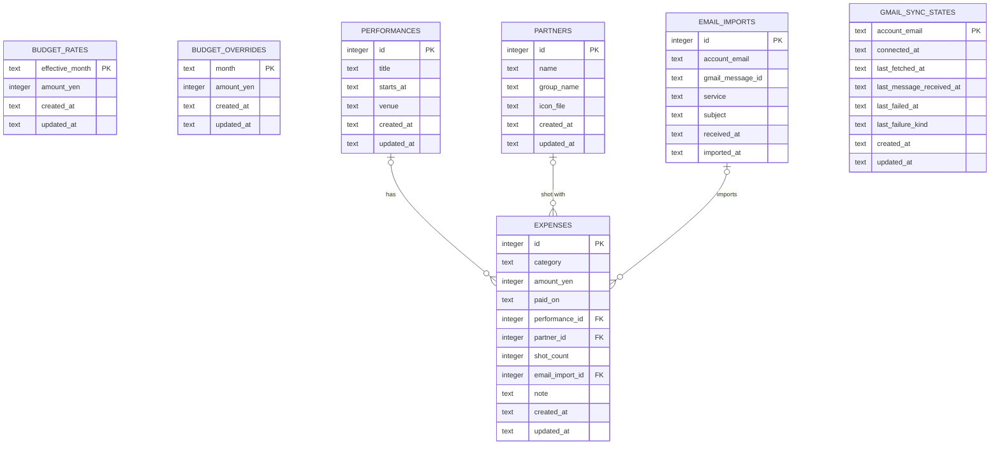

# ローカルDB設計

## 1. 目的と範囲

Kakin の端末内DBです。[SPEC.md](SPEC.md) が定める推し活代・公演・支出・Gmail 自動転記を記録し、月ごとの残高と繰越を計算できる形で保持します。

### 対象

- 推し活代（開始月・月額の履歴・月ごとの上書き）
- 公演（公演名・開始日時・会場）
- 支出（7カテゴリ。チェキ代はチェキ相手と撮影枚数を含む）
- チェキ相手
- Gmail 同期の状態と取り込み済みメール

### 対象外

- 収入
- 複数端末間の同期
- メール本文の保存
- Gmail の OAuth トークン（端末のセキュアストレージに保存し、DB には置かない）
- 計上基準の初期値などの設定（既存の端末設定ストアに置く）
- チェキ相手のアイコン画像そのもの（アプリ専用の領域にファイルで置き、DB はファイル名だけを持つ。4.5）

アプリの振る舞いの正は [SPEC.md](SPEC.md)、用語の正は [GLOSSARY.md](../GLOSSARY.md) です。
この文書はローカルDBのスキーマの正で、テーブル・制約・マイグレーションを変えるときは同じ変更で更新します。
SPEC.md と食い違う場合は SPEC.md に合わせます。

## 2. 設計方針

| 項目       | 決定                                                                                      |
| ---------- | ----------------------------------------------------------------------------------------- |
| DB         | drift 2.34 系 + SQLite。端末内のみで、サーバーは持たない                                  |
| 支出       | 全カテゴリを1つの `expenses` テーブルで持つ。カテゴリ固有の項目は CHECK 制約で整合を守る  |
| 主キー     | 原則 `INTEGER PRIMARY KEY AUTOINCREMENT`。月や Gmail アカウントで一意に決まる表は自然キー |
| 金額       | 日本円の整数（`INTEGER`）。浮動小数点は使わない                                           |
| 日時と日付 | 瞬間は UTC の ISO-8601、暦日・暦月は日本時間の `YYYY-MM-DD` / `YYYY-MM` テキスト（後述）  |
| 残高       | 保存しない。推し活代と支出から毎回計算する                                                |
| 削除       | 確認付きの物理削除。参照整合性は外部キーと CHECK 制約で守る                               |
| メール本文 | 保存しない。件名・受信日時・メッセージIDだけを残す                                        |
| 認証情報   | DB に保存しない。OAuth トークンはセキュアストレージに置く                                 |

### 日時と日付の保存形式

値の意味ごとに列名の接尾辞と形式を揃えます。

| 意味                       | 接尾辞   | 形式                     | 例                         |
| -------------------------- | -------- | ------------------------ | -------------------------- |
| 瞬間（公演開始・受信など） | `_at`    | UTC の ISO-8601 テキスト | `2026-11-14T09:00:00.000Z` |
| 日本時間の暦日（支払日）   | `_on`    | `YYYY-MM-DD` テキスト    | `2026-11-14`               |
| 日本時間の暦月（推し活代） | `_month` | `YYYY-MM` テキスト       | `2026-11`                  |

- `_at` 列は drift の `store_date_time_values_as_text` で保存し、DB へ渡す値は必ず UTC に変換します。表示と暦日への変換は `Asia/Tokyo` で行います。
- `_on` と `_month` 列はタイムゾーンを持たない暦の値です。UTC に変換しません。支払日を UTC の瞬間で持つと、日本時間の深夜0時〜9時の支払いが前日に計上されるためです。
- 暦日と暦月の正しさは CHECK 制約で検証します。SQLite の `date()` は `2026-02-30` を `2026-03-02` に正規化するため、`date(x) IS x` で存在しない日付も弾けます。

## 3. ER図



`BUDGET_RATES` と `BUDGET_OVERRIDES` は月の値で他の表と論理的に対応し、外部キーは持ちません。
`GMAIL_SYNC_STATES` と `EMAIL_IMPORTS` は `account_email` で論理的に対応しますが、連携解除後も取り込み履歴を残すため外部キーは張りません。

## 4. テーブル定義

### 4.1 budget_rates

推し活代の月額の履歴です。1行が「この月からこの月額」を表します（SPEC 3.1）。

| 列                | SQLite型 | NULL | 既定 | 制約                      | 説明                   |
| ----------------- | -------- | ---- | ---- | ------------------------- | ---------------------- |
| `effective_month` | TEXT     | NO   | -    | PK、実在する暦月（CHECK） | この月額を使い始める月 |
| `amount_yen`      | INTEGER  | NO   | -    | `CHECK (amount_yen >= 0)` | 推し活代の月額（円）   |
| `created_at`      | TEXT     | NO   | -    | ISO-8601 UTC              | 作成日時               |
| `updated_at`      | TEXT     | NO   | -    | ISO-8601 UTC              | 更新日時               |

意味と制約:

- 行が1つもなければ推し活代は未設定です（SPEC 3.3）。
- 開始月は `MIN(effective_month)` です。開始月を別の列に持たないことで、開始月と最初の月額が食い違わないようにします。
- ある月の月額は、`effective_month` がその月以前の行のうち最も新しい行の `amount_yen` です。
- 月額を変更すると、変更した月の行を upsert します。過去の月の行は変えません。
- 開始月を早めるときは、最も古い行の `effective_month` を新しい開始月に更新します。
- 開始月を遅らせるときは、1つのトランザクションで、新しい開始月に適用される月額を新しい開始月の行として upsert し、それより前の行と、それより前の月の `budget_overrides` を削除します。

### 4.2 budget_overrides

特定の月だけの推し活代の上書きです（SPEC 3.1）。

| 列           | SQLite型 | NULL | 既定 | 制約                      | 説明                   |
| ------------ | -------- | ---- | ---- | ------------------------- | ---------------------- |
| `month`      | TEXT     | NO   | -    | PK、実在する暦月（CHECK） | 上書きする月           |
| `amount_yen` | INTEGER  | NO   | -    | `CHECK (amount_yen >= 0)` | その月の推し活代（円） |
| `created_at` | TEXT     | NO   | -    | ISO-8601 UTC              | 作成日時               |
| `updated_at` | TEXT     | NO   | -    | ISO-8601 UTC              | 更新日時               |

意味と制約:

- 行があればその月の推し活代は `amount_yen`、なければ `budget_rates` の月額です。上書きの解除は行の削除です。
- 開始月より前の月の行は作りません。開始月より前の月は残高の計算に含まれないためです。

### 4.3 performances

公演を1行で表します（SPEC 4）。チケット代は公演に持たず、`expenses` の行として持ちます。

| 列           | SQLite型 | NULL | 既定 | 制約                   | 説明         |
| ------------ | -------- | ---- | ---- | ---------------------- | ------------ |
| `id`         | INTEGER  | NO   | -    | PK, AUTOINCREMENT      | 主キー       |
| `title`      | TEXT     | NO   | -    | 空文字不可（アプリ側） | 公演名       |
| `starts_at`  | TEXT     | NO   | -    | ISO-8601 UTC           | 公演開始日時 |
| `venue`      | TEXT     | YES  | NULL | -                      | 会場名       |
| `created_at` | TEXT     | NO   | -    | ISO-8601 UTC           | 作成日時     |
| `updated_at` | TEXT     | NO   | -    | ISO-8601 UTC           | 更新日時     |

索引:

- `performances_starts_at`（`starts_at`）: 今後の公演・公演日での集計用
- `performances_title_starts_at`（`title`, `starts_at`）: Gmail 自動転記で同じ公演を探す照合用

意味と制約:

- `(title, starts_at)` に一意制約は置きません。手入力では同名・同日時の公演も登録でき、Gmail 自動転記では一致する公演のうち `id` が最小のものに紐づけます。
- 公演の削除は4.4の手順で行います。

### 4.4 expenses

支出を1行で表します（SPEC 5）。チケット代・ドリンク代・チェキ代・グッズ代・交通費・コインロッカー代・その他を同じ表で持ちます。

| 列                | SQLite型 | NULL | 既定 | 制約                                        | 説明                                   |
| ----------------- | -------- | ---- | ---- | ------------------------------------------- | -------------------------------------- |
| `id`              | INTEGER  | NO   | -    | PK, AUTOINCREMENT                           | 主キー                                 |
| `category`        | TEXT     | NO   | -    | 7種類のいずれか（表の CHECK 制約）          | カテゴリ                               |
| `amount_yen`      | INTEGER  | NO   | -    | `CHECK (amount_yen >= 0)`                   | 金額（円）。手数料を含め実際に払った額 |
| `paid_on`         | TEXT     | NO   | -    | `CHECK (date(paid_on) IS paid_on)`          | 支払日（日本時間の暦日）               |
| `performance_id`  | INTEGER  | YES  | NULL | FK `performances(id)` `ON DELETE SET NULL`  | 紐づく公演                             |
| `partner_id`      | INTEGER  | YES  | NULL | FK `partners(id)` `ON DELETE RESTRICT`      | チェキ相手。チェキ代だけが持つ         |
| `shot_count`      | INTEGER  | YES  | NULL | `CHECK (shot_count > 0)`                    | 撮影枚数。チェキ代だけが持つ           |
| `email_import_id` | INTEGER  | YES  | NULL | FK `email_imports(id)` `ON DELETE SET NULL` | 取り込み元メール。NULL は手入力        |
| `note`            | TEXT     | YES  | NULL | -                                           | メモ                                   |
| `created_at`      | TEXT     | NO   | -    | ISO-8601 UTC                                | 作成日時                               |
| `updated_at`      | TEXT     | NO   | -    | ISO-8601 UTC                                | 更新日時                               |

表の CHECK 制約:

```sql
CHECK (category IN ('ticket', 'drink', 'cheki', 'goods', 'transport', 'locker', 'other')),
CHECK (category NOT IN ('ticket', 'drink', 'cheki') OR performance_id IS NOT NULL),
CHECK (
  (category = 'cheki' AND partner_id IS NOT NULL AND shot_count IS NOT NULL)
  OR (category <> 'cheki' AND partner_id IS NULL AND shot_count IS NULL)
)
```

索引:

- `expenses_paid_on`（`paid_on`）: 支払日での日別・月別集計と残高計算用
- `expenses_performance_id_category`（`performance_id`, `category`）: 公演ごとの支出、今後の公演用
- `expenses_partner_id`（`partner_id`）: チェキ相手の削除時の参照確認用
- `expenses_email_import_id`（`email_import_id`）: 取り込み元との照合用

意味と制約:

- 支払日と公演の開始日時は独立した値です。数ヶ月後の公演のチケット代は、`paid_on` が今月、`performances.starts_at` が数ヶ月後になります。
- チケット代は支払いごとに1行です。同じ公演に `ticket` の行が2つ以上あってもかまいません（SPEC 5.3）。
- チェキ代の `amount_yen` は合計額です。単価は保存せず、入力時の「撮影枚数 × 単価」の結果だけを残します（SPEC 5.5）。同じ公演・同じ相手のチェキ代を複数行に分けて記録できます。
- ドリンク代の初期値（SPEC 5.4）は、`category = 'drink'` の最も新しく作成された行の `amount_yen` から求めます。専用の列や設定は持ちません。
- 「Gmail から取り込み」の印は `email_import_id IS NOT NULL` で表します。支出を編集しても `email_import_id` は変えないため、印は残ります。
- 無料の支出は `amount_yen = 0` とします。

公演の削除（SPEC 4）:

1. 1つのトランザクションで、削除する公演の `ticket` / `drink` / `cheki` の行を削除します。
2. 続けて公演を削除します。残った `goods` / `transport` / `locker` / `other` の行は `ON DELETE SET NULL` で紐づけが外れます。
3. 確認画面の支出の件数と合計額は、削除前に同じ条件で集計します。

手順1を飛ばすと、`SET NULL` の結果が「公演が必須のカテゴリには公演が要る」という CHECK 制約に違反し、公演の削除そのものが失敗します。必須カテゴリの支出が公演なしで残ることはありません。

### 4.5 partners

チェキ相手のマスタです。初回入力時に作成し、以降は既存候補から選びます。

| 列           | SQLite型 | NULL | 既定 | 制約                       | 説明                             |
| ------------ | -------- | ---- | ---- | -------------------------- | -------------------------------- |
| `id`         | INTEGER  | NO   | -    | PK, AUTOINCREMENT          | 主キー                           |
| `name`       | TEXT     | NO   | -    | 空文字不可（アプリ側）     | 表示名                           |
| `group_name` | TEXT     | YES  | NULL | -                          | グループ名・所属（任意）         |
| `icon_file`  | TEXT     | YES  | NULL | ファイル名のみ（アプリ側） | アイコン画像のファイル名（任意） |
| `created_at` | TEXT     | NO   | -    | ISO-8601 UTC               | 作成日時                         |
| `updated_at` | TEXT     | NO   | -    | ISO-8601 UTC               | 更新日時                         |

索引:

- `partners_name`（`name`）: 検索・候補表示用

意味と制約:

- `name` に一意制約は置きません。同名の別人は `group_name` で見分けます（SPEC 5.5）。
- 同一性は `id` で保証し、表示名を変更してもチェキ代の履歴が壊れないようにします。
- チェキ代の履歴がある相手は削除できません（`ON DELETE RESTRICT`）。

アイコン画像（SPEC 5.5）:

- 画像そのものは DB に入れず、アプリ専用の領域（Application Support）の `partner_icons/` に JPEG で保存します。`icon_file` にはそのファイル名だけを入れます。端末を移ったり再インストールしたりして絶対パスが変わっても参照が壊れないようにするためです。
- 保存の前に正方形に切り抜き、512×512 に縮めます。ファイル名は保存のたびに新しい乱数で作ります。差し替えた画像を表示側のキャッシュが古いまま出さないようにするためです。
- 差し替えでは、新しいファイルを書いてから `icon_file` を更新し、コミットの後に古いファイルを消します。画像を外す・相手を削除するときも、コミットの後にファイルを消します。消せなかったファイルは、起動時に `partners.icon_file` から参照されていないファイルを掃除して消します。
- `icon_file` が指すファイルが見つからないときは、画像がないものとして頭文字を表示します。

### 4.6 email_imports

Gmail から取り込みに成功したメールを残します。同じメールの再取り込みを防ぎ、支出の取り込み元を表示するために使います。

| 列                 | SQLite型 | NULL | 既定 | 制約                   | 説明                                    |
| ------------------ | -------- | ---- | ---- | ---------------------- | --------------------------------------- |
| `id`               | INTEGER  | NO   | -    | PK, AUTOINCREMENT      | 主キー                                  |
| `account_email`    | TEXT     | NO   | -    | 空文字不可（アプリ側） | Gmail アカウント                        |
| `gmail_message_id` | TEXT     | NO   | -    | 空文字不可（アプリ側） | Gmail のメッセージID                    |
| `service`          | TEXT     | NO   | -    | `eplus` / `livepocket` | チケットサービス                        |
| `subject`          | TEXT     | NO   | -    | -                      | メール件名                              |
| `received_at`      | TEXT     | NO   | -    | ISO-8601 UTC           | メール受信日時（Gmail の internalDate） |
| `imported_at`      | TEXT     | NO   | -    | ISO-8601 UTC           | 取り込み日時                            |

一意制約:

- `UNIQUE (account_email, gmail_message_id)`

意味と制約:

- 取り込みに成功したメールだけを保存します。公演情報を読み取れなかったメールや対象外のメールは保存しません（SPEC 6.2）。
- メール本文は保存しません。件名・受信日時・メッセージIDだけを残します。
- 支出や公演を削除しても `email_imports` は残します。次回同期で同じメッセージIDをスキップでき、削除したものが戻りません（SPEC 6.2）。
- 取り込むのは決済完了メールだけで、1通がチケット代の支出1件に対応します（SPEC 6.1）。
- 連携を解除しても `email_imports` は残します（SPEC 6.4）。
- 1通から複数公演が取れた場合は、複数の支出が同じ `email_import_id` を参照します。現行の `TicketService.extract` は1通1公演を返すため、複数公演の抽出は将来の拡張です。スキーマの変更は要りません。

### 4.7 gmail_sync_states

Gmail アカウントの同期状態です。連携できるのは1アカウントですが（SPEC 2）、アカウントを主キーにして連携の付け替えを表現します。

| 列                         | SQLite型 | NULL | 既定 | 制約                        | 説明                                             |
| -------------------------- | -------- | ---- | ---- | --------------------------- | ------------------------------------------------ |
| `account_email`            | TEXT     | NO   | -    | PK                          | Gmail アカウント                                 |
| `connected_at`             | TEXT     | NO   | -    | ISO-8601 UTC                | 連携した日時。初回同期の取得範囲の基準           |
| `last_fetched_at`          | TEXT     | YES  | NULL | ISO-8601 UTC                | 最終同期日時（最後に同期が成功した日時）         |
| `last_message_received_at` | TEXT     | YES  | NULL | ISO-8601 UTC                | 受信ウォーターマーク                             |
| `last_failed_at`           | TEXT     | YES  | NULL | ISO-8601 UTC                | 最後に同期が失敗した日時。成功すると NULL に戻す |
| `last_failure_kind`        | TEXT     | YES  | NULL | `reauth_required` / `other` | 最後の失敗の種類。成功すると NULL に戻す         |
| `created_at`               | TEXT     | NO   | -    | ISO-8601 UTC                | 作成日時                                         |
| `updated_at`               | TEXT     | NO   | -    | ISO-8601 UTC                | 更新日時                                         |

表の CHECK 制約:

```sql
CHECK ((last_failed_at IS NULL) = (last_failure_kind IS NULL))
```

意味と制約:

- `last_fetched_at` は同期が成功したときだけ更新します。失敗した同期では更新しません。設定画面の「最終同期日時」に使います（SPEC 8.5）。
- `last_message_received_at` は取り込んだメールの `received_at` の最大値です。取り込んだメールがない同期では変わりません。
- `last_failed_at` と `last_failure_kind` は、バックグラウンド同期の失敗を次にアプリを開いたときに表示するために残します（SPEC 6.4）。`reauth_required` のときは再連携の案内を表示します。
- 連携を解除するときはこの行を削除します。`email_imports` は残すため、再連携しても同じメールは再び取り込まれません。

## 5. 制約と索引のまとめ

### 外部キー

SQLite の外部キーは既定で無効です。DB を開くたびに `PRAGMA foreign_keys = ON` を実行します。

| 親の削除            | 子                            | 動作     | 理由                                                        |
| ------------------- | ----------------------------- | -------- | ----------------------------------------------------------- |
| `performances`      | `expenses.performance_id`     | SET NULL | 任意カテゴリは紐づけを外す。必須カテゴリは事前に削除（4.4） |
| `partners`          | `expenses.partner_id`         | RESTRICT | 履歴がある相手を誤って消さない                              |
| `email_imports`     | `expenses.email_import_id`    | SET NULL | 取り込み元を消しても支出は残す                              |
| `gmail_sync_states` | `email_imports.account_email` | FK なし  | 連携解除後も取り込み履歴を残す                              |

### 一意制約

| テーブル        | 列                                  | 目的                           |
| --------------- | ----------------------------------- | ------------------------------ |
| `email_imports` | `(account_email, gmail_message_id)` | 同じメールの二重取り込みを防ぐ |

`budget_rates.effective_month`・`budget_overrides.month`・`gmail_sync_states.account_email` は主キーで一意です。

### 索引

| テーブル       | 索引名                             | 列                           | 用途                       |
| -------------- | ---------------------------------- | ---------------------------- | -------------------------- |
| `performances` | `performances_starts_at`           | `starts_at`                  | 今後の公演・公演日での集計 |
| `performances` | `performances_title_starts_at`     | `title`, `starts_at`         | Gmail 自動転記の公演照合   |
| `expenses`     | `expenses_paid_on`                 | `paid_on`                    | 支払日での集計・残高計算   |
| `expenses`     | `expenses_performance_id_category` | `performance_id`, `category` | 公演ごとの支出・今後の公演 |
| `expenses`     | `expenses_partner_id`              | `partner_id`                 | チェキ相手の参照確認       |
| `expenses`     | `expenses_email_import_id`         | `email_import_id`            | 取り込み元との照合         |
| `partners`     | `partners_name`                    | `name`                       | 検索・候補表示             |

### CHECK 制約

| テーブル            | 制約                                                             |
| ------------------- | ---------------------------------------------------------------- |
| `budget_rates`      | `amount_yen >= 0`、`effective_month` が実在する暦月              |
| `budget_overrides`  | `amount_yen >= 0`、`month` が実在する暦月                        |
| `expenses`          | `category` が7種類のいずれか                                     |
| `expenses`          | `amount_yen >= 0`、`paid_on` が実在する暦日                      |
| `expenses`          | `ticket` / `drink` / `cheki` は `performance_id` が必須          |
| `expenses`          | `cheki` だけが `partner_id` と `shot_count`（1以上）を持つ       |
| `gmail_sync_states` | `last_failed_at` と `last_failure_kind` は両方 NULL か両方値あり |
| `email_imports`     | `service` が2種類のいずれか                                      |

## 6. 集計クエリ

`:name` はアプリから渡すパラメーターです。月の範囲は `:from_on`（月初）以上 `:to_on`（翌月初）未満の暦日で渡します。

### 残高と繰越

SPEC 3.2 の式を、開始月から対象月までの累計で計算します。
繰越は前月の残高なので、ある月の残高は「開始月からその月までの（推し活代 − 支出）の合計」に等しくなります。

```sql
WITH RECURSIVE
start AS (
  SELECT MIN(effective_month) AS month FROM budget_rates
),
months(month) AS (
  SELECT month FROM start
  WHERE month IS NOT NULL AND month <= :target_month
  UNION ALL
  SELECT strftime('%Y-%m', month || '-01', '+1 month')
  FROM months
  WHERE month < :target_month
),
budget AS (
  SELECT
    m.month,
    COALESCE(
      (SELECT o.amount_yen FROM budget_overrides o WHERE o.month = m.month),
      (SELECT r.amount_yen FROM budget_rates r
       WHERE r.effective_month <= m.month
       ORDER BY r.effective_month DESC LIMIT 1)
    ) AS budget_yen
  FROM months m
),
spend AS (
  SELECT substr(paid_on, 1, 7) AS month, SUM(amount_yen) AS spend_yen
  FROM expenses
  WHERE paid_on >= (SELECT month FROM start) || '-01'
  GROUP BY month
),
ledger AS (
  SELECT
    b.month,
    b.budget_yen,
    COALESCE(s.spend_yen, 0) AS spend_yen,
    SUM(b.budget_yen - COALESCE(s.spend_yen, 0))
      OVER (ORDER BY b.month) AS balance_yen
  FROM budget b
  LEFT JOIN spend s ON s.month = b.month
)
SELECT
  month,
  balance_yen - budget_yen + spend_yen AS carryover_yen,
  budget_yen,
  spend_yen,
  balance_yen
FROM ledger
ORDER BY month;
```

- `budget_rates` が空なら0行を返します。推し活代が未設定のときの表示（SPEC 3.3）に使います。
- 対象月が開始月より前のときも0行です。その月は残高を表示しません。
- 開始月より前の `paid_on` の支出は `spend` に含めません（SPEC 3.2）。
- 残高は常に支払日で計算し、計上基準に依存しません。
- 利用年数が増えても、月数は数十〜数百行の規模です。毎回計算しても十分速いため、月次のスナップショットは持ちません。

### 月の支出合計とカテゴリ別の内訳

計上基準が支払日のとき:

```sql
SELECT category, SUM(amount_yen) AS amount_yen
FROM expenses
WHERE paid_on >= :from_on AND paid_on < :to_on
GROUP BY category;
```

計上基準が公演日のときは、紐づく公演の開始日（日本時間）に置き、公演に紐づかない支出は支払日に置きます（SPEC 7）。

```sql
WITH placed AS (
  SELECT
    e.category,
    e.amount_yen,
    COALESCE(date(p.starts_at, '+9 hours'), e.paid_on) AS placed_on
  FROM expenses e
  LEFT JOIN performances p ON p.id = e.performance_id
)
SELECT category, SUM(amount_yen) AS amount_yen
FROM placed
WHERE placed_on >= :from_on AND placed_on < :to_on
GROUP BY category;
```

カテゴリの行を合計すると月の支出合計になります。

### カレンダーの日別合計

支払日のときは `paid_on`、公演日のときは上の `placed_on` で日ごとに `SUM(amount_yen)` を取ります。
公演の印は、`date(starts_at, '+9 hours')` が表示中の月に入る公演の日付から求めます。

### 今後の公演

```sql
SELECT p.id, p.title, p.starts_at, p.venue
FROM performances p
WHERE date(p.starts_at, '+9 hours') >= :today_on
  AND EXISTS (
    SELECT 1 FROM expenses e
    WHERE e.performance_id = p.id AND e.category = 'ticket'
  )
ORDER BY p.starts_at;
```

`:today_on` は日本時間の今日です。この画面は金額を表示しないため、金額は集計しません（SPEC 8.4）。

### 公演の支出

```sql
SELECT category, SUM(amount_yen) AS amount_yen
FROM expenses
WHERE performance_id = :performance_id
GROUP BY category;
```

公演削除の確認（SPEC 4）では、`category IN ('ticket', 'drink', 'cheki')` に絞った件数と合計額を表示します。

## 7. Gmail同期フロー

同期の契機（手動・週1回のバックグラウンド・初回連携）は SPEC 6.3 が正です。DB はどの契機でも同じ手順で更新します。

### 同期状態

- 表示用の「最終同期日時」は `gmail_sync_states.last_fetched_at` です。
- 次回取得の基準は `gmail_sync_states.last_message_received_at` です。
- 両者は別の値です。同期に成功しても新しい対象メールがなければ、`last_message_received_at` は進みません。

### 取得範囲

| 状態                               | Gmail 検索の `after:`                |
| ---------------------------------- | ------------------------------------ |
| `last_message_received_at` が NULL | `connected_at` の3ヶ月前（SPEC 6.3） |
| `last_message_received_at` がある  | `last_message_received_at` の3日前   |

初回の取得範囲を `connected_at` から決めるため、初回同期が失敗して再試行しても範囲は変わりません。
3日の重なりは受信日時の前後や Gmail 側の反映遅れの吸収用で、重複はメッセージIDで除きます。

### 取り込み手順

1. `gmail_sync_states` から対象アカウントの状態を読む。
2. 取得範囲を決め、Gmail API で対象メールを取得する。
3. 各メールについて `(account_email, gmail_message_id)` が `email_imports` にあればスキップする。
4. `TicketService.extract` で決済完了メールの公演情報を抽出する。null ならスキップし、`email_imports` には保存しない。
5. 取り込みと状態の更新を1つのトランザクションで行う。
   - `email_imports` を1行挿入する。
   - `title` と `starts_at` が一致する公演のうち `id` が最小のものを探し、なければ `performances` に1行挿入する。
   - `expenses` に `category = 'ticket'` の行を挿入する（下のマッピング）。
   - 取り込んだメールの `received_at` の最大値で `last_message_received_at` を更新する。
   - `last_fetched_at` を現在時刻で更新し、`last_failed_at` と `last_failure_kind` を NULL に戻す。
6. 失敗したらトランザクションをロールバックし、`last_fetched_at` と `last_message_received_at` は更新しない。そのうえで、別の書き込みとして `last_failed_at` と `last_failure_kind` を記録する。認証の期限切れや権限の取り消しは `reauth_required`、それ以外は `other` とする。

### 公演情報のマッピング

| `TicketInfo` | 保存先                     | 備考                                 |
| ------------ | -------------------------- | ------------------------------------ |
| `title`      | `performances.title`       | 公演名。照合キーの1つ                |
| `startsAt`   | `performances.starts_at`   | UTC に変換して保存。照合キーの1つ    |
| `venue`      | `performances.venue`       | 新しく公演を作るときだけ使う         |
| 支払総額     | `expenses.amount_yen`      | 支払総額があれば優先する（SPEC 6.2） |
| `price`      | `expenses.amount_yen`      | 支払総額がないときに使う             |
| -            | `expenses.paid_on`         | `received_at` の日本時間の暦日       |
| -            | `expenses.email_import_id` | 挿入した `email_imports.id`          |

現行の `TicketInfo.price` はチケット料金（手数料を含まない券面代金の合計）です。
SPEC 6.2 の「支払総額を優先」を満たすには、`TicketInfo` に支払総額（記載がなければ null）を追加し、各チケットサービスの抽出処理で読み取る必要があります。
追加するまでは `price` を `amount_yen` に使います。

既存の公演に紐づける場合、その公演の公演名・開始日時・会場は変更しません。ユーザーが手で直した値を上書きしないためです。

### 重複排除と再取り込み

- 同じメールは `(account_email, gmail_message_id)` の一意制約で二重に登録されません。
- ユーザーが支出や公演を編集しても、再同期ではメッセージIDでスキップするため、編集内容は上書きされません。
- 支出や公演を削除しても `email_imports` は残るため、削除したものは再同期で戻りません。
- 手入力のチケット代と自動転記のチケット代が同じ公演に並んでも、自動では削除しません（SPEC 5.3）。

### 受信日時の扱い

`received_at` と `last_message_received_at` には Gmail の `internalDate` を使います。メールの `Date` ヘッダは送信者側の時計に依存するため、同期のウォーターマークには使いません。

Gmail API のスコープは読み取り専用（`gmail.readonly`）に限定し、メールの送信・削除は行いません。

## 8. Drift実装方針

### 依存関係

`app/pubspec.yaml` に追加します。

```yaml
dependencies:
  drift: ^2.34.4
  drift_flutter: ^0.3.1

dev_dependencies:
  drift_dev: ">=2.34.0 <2.34.1"
```

このリポジトリは `analyzer: ^12.1.0` に固定されており、`drift_dev` 2.34.1 以降は analyzer 13 以上を要求するため、そのままでは依存解決できません。v1 は analyzer 12 に対応する `drift_dev` 2.34.0 に固定し、ランタイムの `drift` は 2.34 系の最新を使います。`drift_dev` を上げる場合は、analyzer・riverpod_generator・freezed などの生成ツールを同時に更新する別作業として扱います。

### build.yaml

既存の `app/build.yaml` の `builders` に `drift_dev` を追加し、`_at` 列の日時を ISO-8601 テキストとして保存します。既存の `freezed` / `slang_build_runner` の設定は残します。

```yaml
targets:
  $default:
    builders:
      drift_dev:
        options:
          store_date_time_values_as_text: true
```

既存の `builders` に追記する形で設定し、`targets` ブロックごと置き換えないようにします。

### データベースクラス

```dart
part 'app_database.g.dart';

@DriftDatabase(
  tables: [
    BudgetRates,
    BudgetOverrides,
    Performances,
    Expenses,
    Partners,
    EmailImports,
    GmailSyncStates,
  ],
)
final class AppDatabase extends _$AppDatabase {
  AppDatabase(super.e);

  AppDatabase.defaults() : super(driftDatabase(name: 'kakin'));

  @override
  int get schemaVersion => 1;

  @override
  MigrationStrategy get migration => MigrationStrategy(
    onCreate: (m) async {
      await m.createAll();
    },
    beforeOpen: (details) async {
      await customStatement('PRAGMA foreign_keys = ON');
    },
  );
}
```

`driftDatabase(name: 'kakin')` は端末のアプリ Documents 配下に `kakin.sqlite` を作ります。テストでは `NativeDatabase.memory()` を使います。

### テーブル定義の例

```dart
enum ExpenseCategory { ticket, drink, cheki, goods, transport, locker, other }

enum StoredMailService { eplus, livepocket }

@TableIndex(name: 'expenses_paid_on', columns: {#paidOn})
@TableIndex(
  name: 'expenses_performance_id_category',
  columns: {#performanceId, #category},
)
@TableIndex(name: 'expenses_partner_id', columns: {#partnerId})
@TableIndex(name: 'expenses_email_import_id', columns: {#emailImportId})
class Expenses extends Table {
  IntColumn get id => integer().autoIncrement()();
  TextColumn get category => textEnum<ExpenseCategory>()();
  IntColumn get amountYen => integer().customConstraint(
    'NOT NULL CHECK (amount_yen >= 0)',
  )();
  TextColumn get paidOn => text().customConstraint(
    'NOT NULL CHECK (date(paid_on) IS paid_on)',
  )();
  IntColumn get performanceId => integer().nullable().references(
    Performances,
    #id,
    onDelete: KeyAction.setNull,
  )();
  IntColumn get partnerId => integer().nullable().references(
    Partners,
    #id,
    onDelete: KeyAction.restrict,
  )();
  IntColumn get shotCount => integer().nullable().customConstraint(
    'CHECK (shot_count > 0)',
  )();
  IntColumn get emailImportId => integer().nullable().references(
    EmailImports,
    #id,
    onDelete: KeyAction.setNull,
  )();
  TextColumn get note => text().nullable()();
  DateTimeColumn get createdAt =>
      dateTime().clientDefault(() => DateTime.now().toUtc())();
  DateTimeColumn get updatedAt =>
      dateTime().clientDefault(() => DateTime.now().toUtc())();

  @override
  List<String> get customConstraints => [
    "CHECK (category IN ('ticket', 'drink', 'cheki', 'goods', 'transport', 'locker', 'other'))",
    "CHECK (category NOT IN ('ticket', 'drink', 'cheki') "
        'OR performance_id IS NOT NULL)',
    "CHECK ((category = 'cheki' AND partner_id IS NOT NULL "
        'AND shot_count IS NOT NULL) '
        "OR (category <> 'cheki' AND partner_id IS NULL "
        'AND shot_count IS NULL))',
  ];
}

class BudgetRates extends Table {
  TextColumn get effectiveMonth => text().customConstraint(
    "NOT NULL CHECK (date(effective_month || '-01') IS effective_month || '-01')",
  )();
  IntColumn get amountYen => integer().customConstraint(
    'NOT NULL CHECK (amount_yen >= 0)',
  )();
  DateTimeColumn get createdAt =>
      dateTime().clientDefault(() => DateTime.now().toUtc())();
  DateTimeColumn get updatedAt =>
      dateTime().clientDefault(() => DateTime.now().toUtc())();

  @override
  Set<Column> get primaryKey => {effectiveMonth};
}
```

- `customConstraint` は drift の既定制約を置き換えるため、`NOT NULL` を自分で書きます。
- `textEnum` は enum の名前を保存しますが CHECK 制約は付けないため、許す値を表の CHECK 制約で固定します。enum に値を足すときは CHECK 制約とマイグレーションも同時に変えます。
- `paid_on` と `_month` 列は `DateTime` ではなく文字列で持ちます。application では暦日・暦月の値オブジェクトに変換し、infrastructure の外へ文字列を出しません。
- `created_at` と `updated_at` は挿入時に UTC を入れ、`updated_at` は更新処理でも明示的に更新します。
- `EmailImports.service` は `textEnum<StoredMailService>()`、`GmailSyncStates.lastFailureKind` は失敗の種類の enum で保存します。

### 配置と依存方向

```text
app/lib/infrastructure/persistence/drift/
  app_database.dart
  app_database.g.dart
  tables/
  daos/
  repositories/
```

- テーブル・DAO・DB クラスは `infrastructure` に置きます。
- `application` は drift に依存せず、`ExpenseRepository` などの port だけを持ちます。
- `presentation` は drift の row クラスを直接扱わず、application の model と use case を経由します。
- 残高の計算式（SPEC 3.2）は domain の規則として持ち、上の SQL はその規則と同じ結果を返す最適化として扱います。両者が一致することをテストで確かめます。
- 具象 repository の生成は `app/dependency_graph.dart` で行います。
- 生成された `*.g.dart` は手編集せず、`dart run melos run gen` で更新します。
- CI は `app/lib` の生成物の差分と未追跡ファイルを検証します。drift の生成ファイルも生成後にコミットします。

### マイグレーション

初期スキーマは `schemaVersion = 1` です。v1 のスキーマを `app/drift_schemas/` に保存します。

```sh
cd app
mkdir -p drift_schemas
dart run drift_dev schema dump \
  lib/infrastructure/persistence/drift/app_database.dart \
  drift_schemas/
dart run drift_dev schema generate \
  drift_schemas/ \
  test/infrastructure/persistence/drift/generated_migrations/
```

`drift_dev` 2.34.0 の CLI と `SchemaVerifier` は `drift` 2.34.4 とコンパイルできません。
v1 のスキーマは `drift` を一時的に 2.34.0 へ下げて `schema dump` し、`app/drift_schemas/drift_schema_v1.json` に保存しています（lockfile は 2.34.4 のまま）。
移行テスト用コードの `schema generate` は、最初のマイグレーションを追加するときに `drift_dev` を `drift` と揃えて上げてから行います。

スキーマを変更するときは、次の順で行います。

1. `schemaVersion` を上げる。
2. `onUpgrade` に移行処理を書く。
3. `dart run drift_dev schema dump` で新しいスキーマを保存する。
4. `dart run drift_dev schema generate` で移行テスト用コードを更新する。
5. `drift_dev` の `SchemaVerifier` で移行テストを追加する。

### テスト

- `app/test/infrastructure/persistence/drift/` に repository と制約のテストを置く。
- `NativeDatabase.memory()` で DB を作り、`PRAGMA foreign_keys = ON` が有効な状態で検証する。
- CHECK 制約を検証する: 負の金額、存在しない暦日・暦月、公演のないチケット代、チェキ相手のないチェキ代、チェキ以外の撮影枚数。
- 公演の削除を検証する: 必須カテゴリは削除、任意カテゴリは紐づけ解除、必須カテゴリを先に消さないと失敗する。
- 残高を検証する: 繰越のマイナス、月額の変更、月の上書き、開始月より前の支出の除外、推し活代が未設定のとき。
- 計上基準を検証する: 日本時間の深夜の公演が正しい暦日に置かれる、公演のない支出が支払日に置かれる。
- Gmail 同期を検証する: 同じメールのスキップ、既存公演への紐づけ、失敗時のロールバックと失敗種類の記録、削除した支出が戻らない。
- チェキ相手のアイコン画像を検証する: 差し替えで古いファイルが消える、相手の削除でファイルが消える、参照されないファイルの掃除、ファイルがないときの表示。
- `_at` 列を UTC で保存し、読み出し時に UTC の `DateTime` として復元できることを検証する。

## 9. 決定事項と将来の拡張

### 決定事項

- 支出は全カテゴリを1つの表で持ち、カテゴリ固有の項目の整合は CHECK 制約で守る。
- 支払日は日本時間の暦日として持ち、公演の開始日時とは独立させる。
- 残高と繰越は保存せず、推し活代と支出から毎回計算する。計算は常に支払日で行う。
- 推し活代は月額の履歴と月ごとの上書きの2つの表で持つ。開始月は月額の履歴の最も古い月とする。
- 1公演=1行。開始日時は1つで、複数日の公演は初日で登録する。
- チケット代は支払いごとに1行。同じ公演に複数行を許す。
- チェキ代は金額と撮影枚数を持ち、単価は保存しない。
- チェキ相手はマスタで管理し、同名を許す。同一性は ID で保証する。
- チェキ相手のアイコン画像は DB に入れず、アプリ専用の領域にファイルで置き、DB はファイル名だけを持つ。
- Gmail は最終同期日時と受信ウォーターマークを別々に持ち、初回の取得範囲は連携日時から決める。
- 取り込み済みメールは `email_imports` に残し、メッセージIDで重複排除する。
- 金額は円の整数。瞬間は UTC の ISO-8601 テキスト、表示と暦日への変換は `Asia/Tokyo`。

### 将来の拡張

| 要件                           | 追加するもの                                        |
| ------------------------------ | --------------------------------------------------- |
| 新しいチケットサービスの追加   | `TicketMailService` と `email_imports.service` の値 |
| 支払総額の自動転記             | `TicketInfo` の支払総額と各サービスの抽出処理       |
| チケットの枚数                 | `TicketInfo` の枚数と `expenses` の任意列           |
| チェキ相手の非表示・アーカイブ | `partners.archived_at`                              |
| 公演の中止・返金の履歴         | 公演の状態と返金額、または返金テーブル              |
| チケット申込とリマインド       | 申込段階と期限を持つ表、通知の予約                  |
| 海外公演                       | `performances.time_zone`                            |
| 複数端末同期                   | 主キーを UUID/ULID へ移行し、同期用の更新履歴を追加 |
| バックアップ・エクスポート     | DB ファイルの書き出しと読み込み                     |

DB の暗号化は v1 の範囲外です。端末のファイル保護に依存し、必要になった時点で SQLCipher などを別途設計します。
